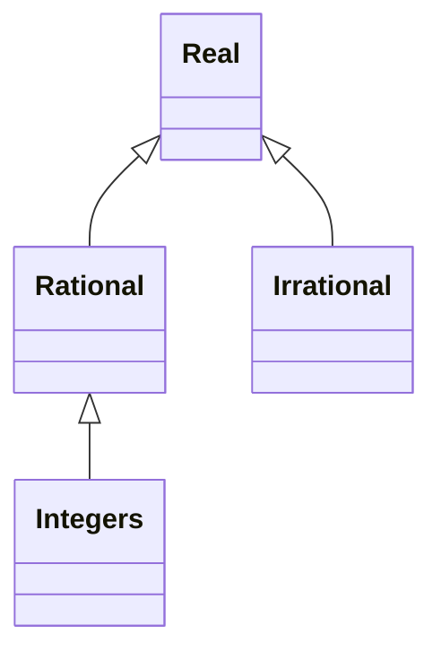

---
tags:
  - math
---
## Algebra and the like

Algebra deals with number systems ($\mathbb{Z}$, $\mathbb{R}$, etc.) and operations ($+$, $-$, etc.).

One such system is the integers, which has negative numbers, positive numbers, and zero. In it, operations, such as $+$, $-$, and $\times$ can be done on all members, but $\div$ cannot always be done.
>Example: $5/3$ is not an integer.

In the rational numbers, all division (except for by $0$) can be done, but some operations like $\sqrt{2}$ cannot be done. [[Proof that sqrt(2) is irrational |Proof]]

Finally, in the real numbers, most square roots and other such operations can be done.

